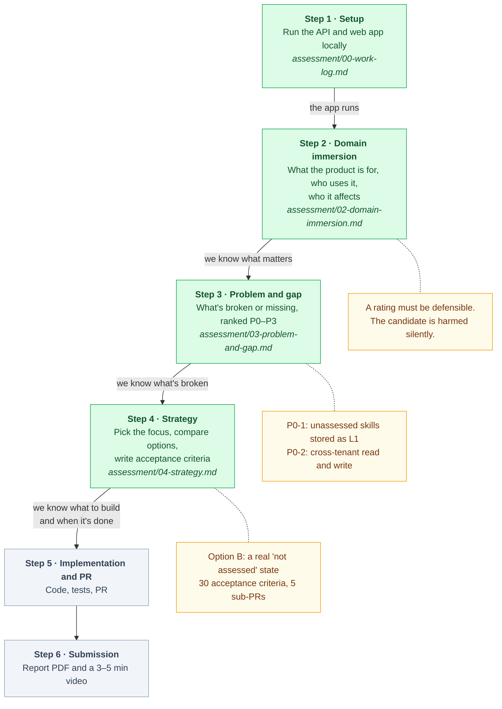

# The Product
Please refer to https://github.com/rakamindev/ai-interview-platform/wiki for initial product specification

# The Platform

A two-service application used for the Product Engineer case study. It is provided as a single repository so the whole thing clones, runs, and releases as one unit.

```
.
├── api/    # Backend service (Ruby on Rails, PostgreSQL, Redis/Sidekiq)
└── web/    # Frontend web app (React 18 + TypeScript, Vite, Tailwind)
```

The two services run together: the web app talks to the API over REST and WebSocket.

## Running it locally

Each service has its own setup guide. Run the API first, then the web app pointed at it.

1. **API** — see [`api/README.md`](api/README.md). Rails app; needs Ruby (see `api/.ruby-version`), PostgreSQL, and Redis. It serves on `http://localhost:3001`.
2. **Web** — see [`web/README.md`](web/README.md). Vite app; `npm install`, copy `.env.example` to `.env`, point `VITE_API_BASE_URL` at the API, then `npm run dev`. It serves on `http://localhost:5173`.

## Running it with Docker

Runs Postgres, Redis, the API, Sidekiq and the web app together.

1. `cp .env.example .env` and set `POSTGRES_PASSWORD`, `REDIS_PASSWORD` and `DEV_ADMIN_PASSWORD` (letters and digits). Postgres and Redis are only reachable from this machine; you sign in as `admin@example.com` with `DEV_ADMIN_PASSWORD`.
2. `cp api/config/application.yml.sample api/config/application.yml` and set `SECRET_KEY_BASE` and `GEMINI_API_KEY`. Database and Redis settings in that file are overridden by `docker-compose.yml`.
3. `docker compose up --build` — the API creates, migrates and seeds the database on startup.
4. Mint a dev JWT and put it in `web/.env` as `VITE_DEV_TOKEN`, then `docker compose restart web`:
   ```bash
   docker compose exec api bundle exec rails runner "puts JsonWebToken.encode({ user_id: 1, role: 'admin', scheme: 'test-corp' }, 30.days)"
   ```
5. Open http://localhost:5173 (API on http://localhost:3001).

Stop with `docker compose down`; add `-v` to also wipe the database.

### Running the API tests

```bash
docker compose exec -e RAILS_ENV=test api bundle exec rails db:create db:schema:load   # first time only
docker compose exec -e RAILS_ENV=test api bundle exec rspec
```

Specs never call Gemini; model responses are stubbed with `spec/support/fake_gemini.rb` and, in
`spec/functional`, with `spec/support/scripted_gemini.rb`. Examples marked `pending` encode known defects from
`assessment/03-problem-and-gap.md`: they are expected to fail until the defect is fixed, at which point RSpec
reports them and the `pending` marker must be removed.

`spec/functional` holds whole journeys driven over HTTP, with background jobs run explicitly: the assessor's path
from setup to export, the failure paths, and known defects end to end. Run just those with
`bundle exec rspec spec/functional`.

`spec/integration` runs against the real Postgres, Redis and Rack stack: database constraints, the coverage
pub/sub channel the live monitor reads, tenant resolution, CORS, rate limits, and Sidekiq jobs run inline with strict
JSON arguments. Jobs are never pushed to the real Redis, because the dev Sidekiq shares it.

### Running the web tests

```bash
docker compose exec web npm test                     # in the dev container (once: docker compose build web)
cd web && npm install --include=dev && npm test      # or on the host, with Node 22+
```

`--include=dev` matters if your shell sets `NODE_ENV=production`, which makes npm skip devDependencies.

Unit tests sit next to the code they test (`*.test.ts(x)` beside the source file): utilities, the API client,
hooks and components, each on its own. `web/src/test/integration` joins REST and the coverage WebSocket on the
live monitor, with the messages in the exact shape the API publishes.

An opt-in contract test runs the web services against the running API. Run it from the host (inside the web
container, Rails' development host check answers 403):

```bash
cd web && API_INTEGRATION_URL=http://localhost:3001/api/v1 \
  API_INTEGRATION_EMAIL=admin@example.com API_INTEGRATION_PASSWORD=<your DEV_ADMIN_PASSWORD> npm test
```

It only creates an assessment without sessions and a vacancy, and deletes both. The tests in `web/src/test/functional` render the whole app at a URL (real
routes, guards, services and error boundary) with Vitest and Testing Library. Only the network is faked, at the HTTP level, with MSW; a request with no
handler fails the test. Fixtures in `web/src/test/fixtures.ts` follow the exact shape of the API's responses.
Known defects use `it.fails`: the test passes while the defect exists, and must become `it` in the commit that fixes
it.

## Notes for the case study

- This is the codebase you assess, harden, and release. Treat it as a version about to ship to a client.
- Work in the `/assessment` folder at the repo root for your written deliverables; code changes go in `api/` or `web/`.
- See the case-study brief you were given for what to produce and how it is evaluated.

### How the case study is worked through

Each step gives the reason for the next one: understand the product, find what's wrong, decide what to change,
then build it. Green steps are done.



### Progress

Rules for working on this repo are in [`GUARDRAILS.md`](GUARDRAILS.md). What's tested, what each test layer is for,
and what's still missing is in [`assessment/testing.md`](assessment/testing.md).

#### Done

- [x] **Step 1 · Setup** ([work log](assessment/00-work-log.md))
  - [x] Docker Compose dev stack; fixed the API crashing on boot (missing `tmp/pids`)
  - [x] Seeded a dev admin so `/login` works on a fresh database
  - [x] Gemini configured locally; retired default model IDs replaced (key never committed)
  - [x] RSpec harness with factories and a stubbed Gemini client: 67 passing specs, plus 11 `pending` specs that
        pin known defects
  - [x] LF line endings pinned for `api/bin/*` and `db/schema.rb`
- [x] **Functional tests** (API and web)
  - [x] API: whole journeys over HTTP (`api/spec/functional`): 11 passing, 3 `pending` known defects
  - [x] Web: Vitest + Testing Library + MSW harness; 14 passing page-level tests, 11 `it.fails` known defects
- [x] **Unit tests** (API and web)
  - [x] API: prompt compiler, session start/end, JWT, audio buffer, Gemini HTTP client, PDF export, request
        authorization, model validations, workers: 72 passing, 3 `pending`
  - [x] Web: utilities, API client, polling hook and components: 48 passing, 10 `it.fails`
- [x] **Integration tests** (API and web)
  - [x] API: Postgres constraints, the Redis coverage channel, the Rack request pipeline, Sidekiq jobs inline: 28
        passing
  - [x] Web: live monitor over REST + WebSocket (5 passing, 2 `it.fails`); contract test against the running API
        (7 passing, opt-in)
- [x] **Totals:** API 263 examples, 0 failures, 6 pending. Web 130 tests: 111 passing, 19 expected to fail (104 and 7
      skipped without the API). Every known-defect test checked to fail on its assertion; deliberate faults were
      caught in each suite
- [x] **Step 2 · Domain immersion** ([02-domain-immersion.md](assessment/02-domain-immersion.md)): five pillars,
      AI adoption in Indonesian hiring, UU PDP mapping, Gemini free-tier constraint
- [x] **Step 3 · Problem and gap** ([03-problem-and-gap.md](assessment/03-problem-and-gap.md)): findings ranked
      P0–P3 and reproduced, including the assessment list (P1-8, P1-9, P2-6..P2-10), the candidate link (P1-10),
      findings from the functional, unit and integration tests (P1-11..P1-13, P2-11..P2-13), and constraint
      signals C1–C8
- [x] **Step 4 · Strategy** ([04-strategy.md](assessment/04-strategy.md)): 30 acceptance criteria, options A/B/C
      compared, Option B chosen, delivery plan

#### Not done yet

- [ ] **Step 5 · Implementation and PR** (Option B: umbrella PR + focused sub-PRs). The API changes, step by step,
      from request to test: [05-api-walkthrough.md](assessment/05-api-walkthrough.md); the web changes:
      [06-web-walkthrough.md](assessment/06-web-walkthrough.md)
  - [x] Sub-PR 1: tenant scoping for portfolio export, override and fit/gap reads and writes (P0-2); 5 specs flip
        to passing, checked over HTTP ([work log](assessment/00-work-log.md#step-5-implementation))
  - [x] Sub-PR 2: web tolerates a missing level (AC-23, P2-11): "Not assessed" instead of L1 or a crash; 29
        `it.fails` flip to passing
  - [x] Sub-PR 3: data model + portfolio generator (AC-1..AC-12, AC-17..AC-21): "not assessed" is stored with a
        reason; checked with the real model and a rollback on the dev database
  - [x] Sub-PR 4: fit/gap engine + payload (AC-13..AC-16): not-assessed skills are unknowns, not gaps; checked
        with the real model
  - [ ] Sub-PR 5: portfolio and fit/gap screens (AC-22, AC-24..AC-30); the web test runner is in place
  - [ ] Known defects in the chosen scope fixed: their `pending` specs and `it.fails` tests flip to passing
  - [x] Seeded fault test: the clamp put back on `scratch/seeded-fault-clamp`, caught by 13 specs, reverted
        (`27f49f3`, `5b34128`)
  - [ ] AI verification moments written up for the report (6 logged so far in the work log)
  - [ ] Screenshots of every state: assessed, not assessed, mixed, generating, failed, long text, 375px
  - [ ] Umbrella PR opened against `rakamindev/ai-interview-platform`
- [ ] **Step 6 · Submission**
  - [ ] Report PDF: PR link, narrative for Steps 2–5, screenshots
    - Draft: [`assessment/report/report.html`](assessment/report/report.html), built to PDF with
      `assessment/report/build.sh`. Steps 2–4 and the AI verification moments are written; Step 5, the PR and video
      links, and the screenshots are marked "To fill in"
  - [ ] 3–5 minute video (unlisted link)

#### Open questions

- [ ] Step 2, Pillar 2: confirm the hiring-market assumptions against the candidate's own experience
- [ ] Step 4: confirm that the coverage map may overrule the model for skills never probed
- [ ] The deadline in the brief has no year; confirm the actual date
